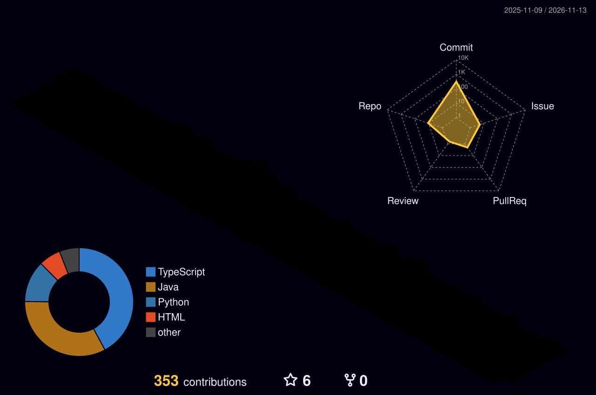

<!-- ═══════════════════════ HERO ═══════════════════════ -->


<p align="center">
  
</p>

<p align="center">
  <a href="https://www.linkedin.com/in/nurjahan-shiah-5a9a291a1/"></a>
  <a href="mailto:nurjahanahmed7@gmail.com"></a>
  
  
</p>

<!-- ═══════════════════════ ABOUT ═══════════════════════ -->


Hello, I'm **Shiah**, a **Software Engineering student (Big Data stream)** at the **Lassonde School of Engineering, York University**, graduating in **April 2027**.

I like the parts of software most people avoid: the **data pipeline behind the feature**, the **service boundaries behind the UI**, and the **system design behind the demo**. I've shipped full-stack code in a government co-op, done LLM research, and led a team that took a 12-service platform from whiteboard to deployment.

```python
class Shiah:
    Interested role      = "Software Engineer/Developer - AI/LLM - Data based roles"
    school    = "Lassonde School of Engineering, York University, SWE (Big Data), class of 2027"
    building  = ["LLM-powered pipelines", "scalable microservices", "Data Platforms"]
    Teaching-Assistant = ["ENG 1101", "ENG 1102", "ENG 2001", "ENG 2003"]

    def looking_for(self):
        return "SWE / ML / Backend roles where I can own real systems"
```
<!-- ═══════════════════════ FEATURED WORK ═══════════════════════ -->


<!-- TODO: replace each "#" with the repo link (or delete the Code link if the repo is private) -->

<table>
  <tr>
    <td colspan="2" valign="top">
      <h3>📚 StudySynq</h3>
      <p><b>AI-powered study platform on 12 microservices</b> · Team lead</p>
      <p>A full platform with a Next.js frontend, 12 FastAPI services, a Delta Lake ETL pipeline, and LLM-driven course suggestions, deployed on Render and Vercel.</p>
      <ul>
        <li><b>Led the team</b> from architecture to final delivery</li>
        <li>Owned the <b>ETL pipeline</b>, <b>recommendation engine</b>, AI course suggestions, admin dashboard, and signup flow</li>
        <li>Shipped with a pytest suite, full documentation, and an in-app product tour</li>
      </ul>
      <p>
        
        
        
        
        
      </p>
      <p><a href="#">Code</a></p>
    </td>
  </tr>
  <tr>
    <td width="50%" valign="top">
      <h3>🌐 Conflict Cascades in Reddit Communities</h3>
      <p><b>Network science on how online conflict spreads</b> · Group project</p>
      <p>Graph analysis of cross-community conflict on Reddit. I own the prediction track: framing the problem, features, and evaluation setup for forecasting where conflict spreads next.</p>
      <p>
        
        
        
      </p>
      <p><a href="#">Code</a></p>
    </td>
    <td width="50%" valign="top">
      <h3>🏛️ Public-Sector Full-Stack & LLM Research</h3>
      <p><b>Co-op and research experience</b></p>
      <ul>
        <li><b>Developer co-op (government):</b> full-stack delivery with .NET and React, including modernizing a legacy low-code app</li>
        <li><b>LLM research (LURA):</b> undergraduate research on large language model systems</li>
        <li><b>Teaching Assistant:</b> ENG 1102 and ENG 2003 at York</li>
      </ul>
      <p>
        
        
        
      </p>
    </td>
  </tr>
</table>

<br/>

<!-- ═══════════════════════ TECH STACK ═══════════════════════ -->


<table>
  <tr>
    <td><b>Languages</b></td>
    <td> &nbsp;<code>SQL</code></td>
  </tr>
  <tr>
    <td><b>Backend</b></td>
    <td> &nbsp;<code>REST</code> <code>Microservices</code> <code>MVC</code></td>
  </tr>
  <tr>
    <td><b>Frontend</b></td>
    <td></td>
  </tr>
  <tr>
    <td><b>AI / Data</b></td>
    <td> &nbsp;<code>LLMs</code> <code>RAG</code> <code>Prompt Engineering</code> <code>Delta Lake</code> <code>ETL</code></td>
  </tr>
  <tr>
    <td><b>Databases</b></td>
    <td></td>
  </tr>
  <tr>
    <td><b>Cloud & DevOps</b></td>
    <td> &nbsp;<code>CI/CD</code></td>
  </tr>
  <tr>
    <td><b>Observability & Tools</b></td>
    <td> &nbsp;<code>OpenZipkin</code> <code>Palladio</code></td>
  </tr>
</table>

<br/>

<!-- ═══════════════════════ ACTIVITY ═══════════════════════ -->


<!-- 3D contribution skyline: generated by .github/workflows/profile-3d.yml (run it once from the Actions tab) -->
<p align="center">
  
</p>

<p align="center">
  
</p>

<p align="center">
  
</p>

<br/>

<!-- ═══════════════════════ CONTACT ═══════════════════════ -->


I'm looking for **SWE, backend, and ML/AI roles for 2027**. If you're building systems where reliability, data, and AI meet, I'd like to hear about it.

<p align="center">
  <a href="https://www.linkedin.com/in/nurjahan-shiah-5a9a291a1/"></a>
  <a href="mailto:nurjahanahmed7@gmail.com"></a>
  <a href="mailto:nshiah49@my.yorku.ca"></a>
</p>


